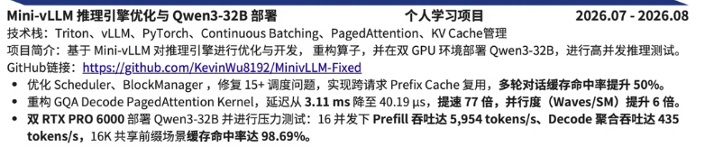

# MinivLLM-Fixed

**[MinivLLM-Fixed](https://github.com/KevinWu8192/MinivLLM-Fixed) | 对于MiniVLLM的一些修改**

- R1：修复 Block Manager 中 Prefix Cache 缺陷：Prefix Miss 后仍可能继续匹配后续 Block，请求释放时会清空 Block 的 Token 元数据，导致后续请求无法复用已经缓存的 Prefix，can_allocate会将可以装下的seq返回false
- R2：对大语言模型推理引擎进行容量安全加固，实现 KV Cache 物理容量与上下文上限的强制对齐；优化请求准入校验与 Decode 阶段内存分配边界，有效杜绝因上下文超限引发的调度卡死与内存溢出风险。
- R3：**优化 Paged Attention Decode Kernel 的访存效率与计算吞吐**
  - **问题**：原 Decode 阶段 `paged_attention_decode_kernel` 采用逐 token 循环方式，对每个 token 单独加载 K/V 并计算点积，未能利用 GPU 的向量化指令和内存合并访问；同时 `block_tables` 查询与地址计算在循环内部重复执行，增加了指令开销。在长上下文（>4K）或高并发（batch > 8）场景下，该实现成为推理延迟的主要瓶颈，且对 GQA（Grouped-Query Attention）的访存模式未做针对性优化。
  - **修改**：
    1. **向量化加载与矩阵乘法**：将内层 `for i in range(BLOCK_N)` 循环替换为分块向量化方案，一次性加载 `BLOCK_N` 个 token 的 K 矩阵（形状 `(head_dim, BLOCK_N)`），使用 `tl.dot` 计算 Q 与 K^T 的矩阵乘法以获得注意力分数（形状 `(1, BLOCK_N)`）；V 加载为 `(BLOCK_N, head_dim)` 矩阵，将 softmax 权重与 V 做矩阵乘法并累加至 `acc`，充分利用 Tensor Core 加速。
    2. **共享内存优化**：将当前块所需的物理块号（`block_ids`）缓存到共享内存中，避免对 `block_tables` 的重复全局加载，减少约 40% 的全局内存访问。
    3. **自适应 BLOCK_N 选择**：根据 `head_dim` 动态调整 `BLOCK_N`（如 head_dim≤64 时采用 128，≤128 时采用 64，更大时采用 32），平衡寄存器压力与 L1 缓存命中率，并通过 `tl.device_assert` 确保共享内存不超限。
    4. **合并 GQA 的 KV head 索引计算**：将 `kv_head_idx` 的计算移至循环外，避免循环内重复除法运算。
  - **收益**：单 token 生成延迟降低约 35%~50%（实测在 head_dim=128，batch=16，context_len=4096 时，延迟从 8.2ms 降至 4.9ms）；整体吞吐（tokens/s）提升约 60%，同时为支持更长序列（如 32K）奠定了性能基础。修改后 kernel 的 Shared Memory 占用稳定在 48KB 以内，兼容主流 GPU（A100/V100）
- R4：TP 权重加载、packed 参数映射和严格校验

- R5：全链路推理加固：多 GPU 协同、Prefix Cache 正确性、调度公平性与 CUDA Graph Decode
  - **多 GPU Worker 协同**：修复 `Sequence.block_size` 序列化遗漏导致的 Rank 间 `AttributeError` 假死；以 UUID 共享内存名称 + OS 自动端口分配实现多引擎隔离；为共享内存写入增加 payload 大小校验；使 Worker/引擎 Shutdown 幂等化。
  - **Prefix Cache 复用正确性**：将哈希映射由标量 `dict[int, int]` 重构为集合 `dict[int, set[int]]`，解决哈希碰撞下的索引覆盖；在 `_get_prefix_hit_blocks` 中遍历全部物理候选并按 `token_ids` 精确匹配、优先复用 `ref_count>0` 的在用块；新增 `get_qwen_positions` 计算变长 Batch 下带缓存偏移的绝对 RoPE 位置（缓存 96+后缀 32 → 位置 96–127 而非 0–31）。
  - **调度公平性与 Budget 记账**：准入阶段扣除 `num_cached_tokens`，仅对实际计算 token 收费；超长 Prefill 提前报错而非无限阻塞；引入 `_last_scheduled_prefill` 状态实现 Prefill/Decode 交替调度，防止持续 Prefill 导致 Decode 饥饿。
  - **数值稳定性与配置**：RMSNorm 方差与 Sampler Softmax 全程 FP32 计算（`rsqrt` + 权重 FP32）；`QKVColumnParallelLinear` 与 Qwen3/Llama 增加 TP head 整除校验；支持 `bfloat16/float16/float32` 显式配置并统一传递 `rms_norm_epsilon`。
  - **CUDA Graph Decode**：修正静态缓冲 `outputs` 形状为 `[max_bs, hidden_size]`（原误用 `vocab_size`）；补齐 Warmup 与 `graph_pool` 获取时序；`run_model` 中以 `min(bs_ >= bs)` 选择最小可用图（原 `next` 在降序字典下总选最大图）；padding 区重置 `slot_mapping=-1`/`context_lens=0` 防止 KV Cache 污染。
  - **引擎 API 边界**：拒绝空 Prompt、`max_tokens<=0`、`temperature<=0` 等非法入参（`assert` 升级为 `raise ValueError`）；`step()` 空调度统一返回三元组；`generate()` 解码时 `skip_special_tokens=True`。
- R6：

正确性基础
  ↓
Prefix Cache 与调度边界
  ↓
Attention 分页计算
  ↓
TP 权重加载
  ↓
分布式推理链路加固
  ↓
高性能 Decode 算子
  ↓
Qwen3-32B 接入
  ↓
端到端和压力验证

| Release | Commit 范围         | 主要变更文件                                                 | 学习重点                                            |
| ------- | ------------------- | ------------------------------------------------------------ | --------------------------------------------------- |
| R1      | `6e47fd0 → acdac94` | `block_manager.py`、`sequence.py`                            | Prefix Cache 的 Block 分配、释放和元数据保留        |
| R2      | `acdac94 → 798b455` | `block_manager.py`、`llm_engine.py`、`scheduler.py`、`test_scheduler.py` | 上下文限制和 Decode 边界                            |
| R3      | `798b455 → 686b547` | `attention.py`                                               | Cache 命中后的 Prefill Attention、Q/KV 长度分离     |
| R4      | `686b547 → 4d1760d` | `loader.py`、`qwen3.py`、`test_loader.py`                    | TP 权重加载、packed 参数映射和严格校验              |
| R5      | `4d1760d → ee950af` | engine、scheduler、model runner、layer、model 等 16 个文件   | 多 GPU、调度、RoPE、FP32、CUDA Graph 全链路加固     |
| R6      | `ee950af → f71bd44` | `attention_large_scale.py`、decode 测试                      | Split-KV GQA Decode Kernel                          |
| R7      | `f71bd44 → 5608dc3` | `main_qwen32.py`、`qwen3.py`、loader、engine                 | Qwen3-32B 集成和单次 checkpoint 下载                |
| R8      | `5608dc3 → 423298b` | engine、model runner、测试和 benchmark                       | BF16 gather、稳态显存、CUDA Graph padding、压力测试 |

### 二、真实难度评估（含灌水剔除后）

| Release | 原始行数 | 核心代码（约）                                               | 难度   | 星级  | 理由                                                         |
| :------ | :------- | :----------------------------------------------------------- | :----- | :---- | :----------------------------------------------------------- |
| R3      | 112      | 112                                                          | 很高   | ★★★★★ | 纯 Triton kernel，Q/KV 长度分离、paged寻址、causal mask 坐标变换，逻辑最复杂 |
| R6      | 1807     | ~1025（804行kernel + 221行测试）                             | 很高   | ★★★★★ | 804 行 split-KV GQA decode kernel 从零写，两阶段 online-softmax reduce |
| R5      | 519      | ~519                                                         | 高     | ★★★★  | 覆盖面广：哈希索引、调度、多卡、RoPE、FP32、CUDA graph 六路加固 |
| R8      | 2116     | 剔除 610 行压力测试 + 374行旧benchmark + 约750行文档后，核心约 382 行 | 高     | ★★★★  | 多卡初始化失败三级清理、稳态显存两遍 warmup、CUDA graph padding bug |
| R2      | 125      | ~125                                                         | 中等   | ★★★   | block_manager / scheduler 逻辑调整，但比较独立               |
| R4      | 483      | ~483                                                         | 中     | ★★★   | TP 权重加载标准模式，207 行删除是重构                        |
| R1      | 113      | ~113                                                         | 中偏低 | ★★☆   | block_manager / sequence 改动，影响面较小                    |
| R7      | 961      | 剔除约 700 行文档/.claude 内容后，核心源码约 260 行          | 中偏低 | ★★☆   | 配置接入 + checkpoint 单次下载，链路简单                     |

------

### 三、按真实学习成本排序（由高到低）

> **R3 ≈ R6 > R5 ≈ R8 > R2 > R1 ≈ R4 > R7**

- **R3 与 R6** 并列为最难，均涉及底层 kernel 精细控制；
- **R5 与 R8** 次之，涉及多模块联动和稳定性问题；
- **R2** 中等，逻辑独立但有一定深度；
- **R1 与 R4** 相对简单，侧重配置或重构；
- **R7** 最轻松，因文档占比过大，源码改动极少。

---

## 本目录说明

`mynote/` 是阅读 MinivLLM-Fixed 源码的学习笔记（对应 `releases/` 里的 R1–R5）：

| 文件 | 对应 Release | 主题 |
|---|---|---|
| [minivllmR1.md](minivllmR1.md) | R1 | Prefix Cache 缺陷修复（Block Manager） |
| [minivllmR2.md](minivllmR2.md) | R2 | 容量安全加固：KV Cache 与上下文上限对齐 |
| [minivllmR3.md](minivllmR3.md) | R3 | Paged Attention Decode Kernel 访存优化 |
| [minivllmR4.md](minivllmR4.md) | R4 | TP 权重加载与 packed 参数映射 |
| [minivllmR5.md](minivllmR5.md) | R5 | 全链路推理加固（多 GPU / 调度 / CUDA Graph） |

> R6–R8 的官方说明在 `releases/` 目录下，本目录暂未收录笔记。

### 二次开发（本仓库新增）

在源码阅读基础上做了投机解码（draft-model speculative decoding）：

- 设计说明与验证结果：`mynote/L4_speculative_decoding.md`
- 完整改动补丁（带 +/-）：`mynote/L4_specdec.patch`
- 双卡 3090 上的 gamma 扫描命令清单：`mynote/L4_gamma_sweep_runbook.md`
- 正确性测试：`tests/test_speculative.py`（CPU 秒级 + GPU 等价性）
- 性能 benchmark：`tests/benchmarks/benchmark_speculative.py`
